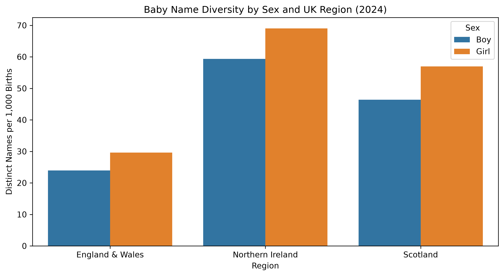

# Name Diversity by Sex and Region

This analysis uses the England & Wales, Northern Ireland, and Scotland baby-name datasets to compare name diversity in **2024**.

The notebook `script/unique_boys_girls_names.ipynb` filters each dataset to 2024 and records with nonmissing birth counts, groups the observations by sex, and compares the number of distinct names per 1,000 births across regions.

## Baby-name diversity in 2024

## Method and source

The source analysis is in [the name-diversity notebook on GitHub](https://github.com/joycieowo/stat159_tidytuesday/blob/main/script/unique_boys_girls_names.ipynb). Counts of rare names are suppressed in the published datasets, so measured diversity is based on the names present in those datasets rather than all births' names. Consult [data sources](data-sources.md) for regional reporting differences.
